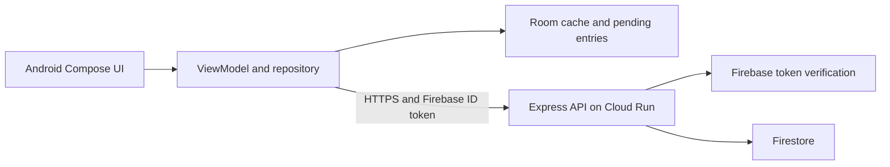

# Android Car Mileage Tracker Plan

## Purpose and agreed scope

Build a personal Android app for two users who share a small number of cars. Both users sign in with their own Google accounts. The project demonstrates Android development and a custom backend while keeping hosting within available free usage allowances where possible.

This document records the agreed scope. Local implementation now lives in `android/` and `backend/`; see the root README for setup and validation. Cloud resources and the GitHub remote require account-specific configuration.

Agreed assumptions:

- Kilometers, liters, and EUR only for the initial release.
- At most one fueling record per car per calendar day; the two users will not submit different entries for the same car on the same day.
- One signed-in account per phone installation. To switch accounts, clear app data and sign in again. No account-switching UI is planned.
- Both users have access to all manually provisioned shared cars, with equal ability to add records.
- Enter current odometer, liters purchased, total paid, and fueling date. Liters and total paid accept up to two decimal places.
- Derive and display price per liter to two decimal places. Do not ask for it as an input.
- No full-tank tracking or fuel-consumption calculation. Liters purchased do not establish liters consumed between odometer readings.
- No invitation system, membership roles, car-management UI, entry editing/deletion UI, charts, or unit conversion in the initial release. Administrative corrections can be made manually.

## Selected technology

| Area | Choice |
| --- | --- |
| Android | Kotlin, Jetpack Compose, ViewModels, StateFlow and coroutines |
| Local storage | Room for cached history and pending entries |
| Networking | Retrofit and OkHttp |
| Deferred sync | WorkManager |
| Sign-in | Android Credential Manager with Google sign-in, connected to Firebase Authentication |
| Backend | Node.js LTS, TypeScript in strict mode, Express REST API |
| Database | Cloud Firestore Standard edition in Native mode |
| API hosting | Google Cloud Run with request-based billing and minimum instances set to zero |
| Android IDE | Android Studio |
| Backend editor | Visual Studio Code |

Use the supported LTS Node.js release available when implementation starts and pin it in the backend folder. Use npm with a committed lockfile. Keep backend code in small routes, services, and data-access folders; use three Android Gradle modules: app, pure Kotlin domain, and Android-library data.



The Android app accesses Firestore through the API. It does not use the Firestore Android SDK for application data. This keeps backend authorization and validation explicit.

## Repositories and development tools

Use one Git repository named `car-mileage-tracker` under your personal GitHub account. Android and backend code share one history, so an API change and its Android integration can be reviewed in the same pull request. Each application retains its own dependencies, build commands, and deployment lifecycle.

Proposed layout:

```text
car-mileage-tracker/
├── README.md                         # Project overview and setup entry point
├── ANDROID_MILEAGE_TRACKER_PLAN.md    # This evolving plan
├── android/                          # Android Studio project and Gradle wrapper
│   └── README.md                     # Android setup and build commands
├── backend/                          # TypeScript/Express API and npm lockfile
│   └── README.md                     # Local API/emulator setup and provisioning
├── docs/
│   └── openapi.yaml                  # Canonical API contract
└── .github/
    └── workflows/                    # Android checks, backend checks, deployment
```

Open `android/` in Android Studio and `backend/` in VS Code. The root README links to both setup guides, the architecture plan, and the API contract. Version the HTTP API under `/v1` and keep changes compatible with installed app versions even though both sides live in the same repository.

Host the repository on your personal GitHub account. Start private while developing; publishing the source for interviewers can be a later decision. The GitHub username and repository creation are deferred until implementation. This project folder can become the repository root; no additional repository or Git submodule is needed.

Use separate GitHub Actions workflows for Android and backend checks, with path filters so unrelated changes do not trigger every build. Changes to the shared API contract should trigger checks for both. Keep backend deployment separate from validation and deploy only `backend/` to Cloud Run after its checks succeed. Store deployment configuration in the repository and use GitHub-to-Google Cloud workload identity federation for deployment credentials when CI deployment is introduced.

VS Code is a suitable free choice for the backend you already have installed. It includes TypeScript editing and Node.js debugging support. Add ESLint and Prettier extensions if useful; run the same checks through npm scripts so they also work outside the editor. Use the integrated terminal for npm, Firebase emulators, and Google Cloud commands. No paid IDE or paid AI subscription is required.

## User flows

1. Sign in with Google. The app exchanges the Google credential through Firebase Authentication, then sends a Firebase ID token to the API.
2. The API verifies the token and checks that the Firebase UID is one of the two provisioned users.
3. Show the shared cars and cached history. Refresh from the backend when online.
4. Select a car and enter fueling date (default today), integer odometer in km, liters, and total EUR paid.
5. Preview derived EUR per liter, save locally, and show pending or synced status.
6. Upload pending entries when online and fetch the complete car history afterward.

A user who successfully signs in with Google but has not been provisioned sees an access-not-configured message. Signing in alone does not grant access to the shared cars.

## Firestore data model

| Document path | Fields |
| --- | --- |
| `users/{firebaseUid}` | `displayName`, `email`, `enabled` |
| `cars/{carId}` | `displayName`, `memberUids` containing the two provisioned UIDs |
| `cars/{carId}/fuelEntries/{entryId}` | `fuelDate`, `odometerKm`, `litersHundredths`, `totalPriceCents`, `createdByUid`, server-generated `createdAt` |

Use a client-generated UUID for each entry. `fuelDate` is a local calendar date formatted `YYYY-MM-DD`, interpreted in Europe/Lisbon for this initial scope. Keep it separate from the server's UTC creation timestamp, since an offline entry may arrive days later.

Store liters and money as integers: 42.37 L becomes `4237`; EUR 75.20 becomes `7520`. This avoids relying on a database decimal type or binary floating-point arithmetic. Send those integer values through the API. Parse decimal inputs directly into integers; support Portuguese comma and dot input without changing the stored precision.

Price per liter is derived from total cents divided by liters hundredths, in EUR/L. For example, EUR 75.20 / 42.37 L is displayed as EUR 1.77/L using half-up rounding to two decimal places. Keep the original liters and total paid authoritative; do not reconstruct the total from the rounded unit price. Weighted average price is total paid divided by total liters, rather than the mean of displayed unit prices.

## Validation and retry rules

- Odometer must be a nonnegative integer; liters and total price must be positive and accept at most two decimal places. Reject excessive precision rather than silently rounding the supplied values.
- Only one record per car and fueling date is supported. Reject a second distinct record for that date with a clear conflict message. Enforce the check and write together in a Firestore transaction.
- Accept delayed offline uploads: compare an entry's odometer with earlier and later records by fueling date, rather than with the most recently uploaded record. Require strictly increasing readings by date. Odometer replacement and resets are outside this release.
- The no-same-day-submissions assumption removes collaborative edit handling, but network retries can still repeat a request. Create entries using a stable client UUID. A repeat with identical stored input returns the existing record; the same UUID with different content returns a conflict.
- Check user provisioning and car membership before reading, creating, or returning an existing record. Derive `createdByUid` from the verified token.
- Do not retry validation or conflict errors automatically. Keep the pending record visible with its failure explanation. Retry temporary network/server failures with backoff.

## Complete-history refresh and offline behavior

Fetch the complete list for a car when its history screen opens, on manual refresh, and after successful upload. This is sufficient for the expected small dataset; there are no realtime listeners, incremental cursors, or pagination in the first release. Show the last successful refresh time so users understand when cached data may be stale.

Replace that car's synced Room records with the successful server response in one local transaction. Preserve pending local records separately and merge the display by entry UUID to avoid duplicate rows. A failed fetch leaves the cache intact. A complete successful response also reflects administrative corrections and deletions without needing deletion markers.

WorkManager uploads pending entries using the original account identity. With one account per installation, no account migration is needed. Clearing app data removes cached history and unsynced entries; users should sync before doing so. Synced records remain on the backend and are restored by a complete fetch.

If authentication needs renewal, pause uploads and request sign-in to the same account. If provisioning or membership is removed, stop retries and block access. Immediate remote erasure of already cached offline data is outside the personal-project scope.

## API contract

All data endpoints verify the Firebase ID token and enforce provisioning and membership checks.

| Method and path | Purpose |
| --- | --- |
| `GET /health` | Minimal service health response with no private data |
| `GET /v1/me` | Return the provisioned user's profile |
| `GET /v1/cars` | Return shared cars accessible to that user |
| `GET /v1/cars/{carId}/fuel-entries` | Return complete history, ordered by fueling date |
| `PUT /v1/cars/{carId}/fuel-entries/{entryId}` | Create a record with a client UUID; identical repeats return the same record |

`PUT` has create-only semantics for new payloads in this release: it cannot overwrite an existing entry. Document success, authentication, authorization, validation, conflict, and temporary failure responses in OpenAPI. Keep entry input and output types explicit and give errors stable machine-readable codes plus user-facing messages.

## Manual provisioning runbook

1. Create a Firebase/Google Cloud project, enable Firebase Authentication's Google provider, and register the Android app and required signing fingerprints. Configure Credential Manager with the matching client configuration.
2. Each of the two people signs in once using the app. This creates their Firebase Authentication account even if the API initially refuses access.
3. In Firebase Console, open Authentication > Users and copy each Firebase UID. Use these stable IDs, rather than email addresses, for authorization.
4. Create `users/{uid}` documents for those exact UIDs with `enabled: true`, display name, and email. Do this in the Firestore console using your administrator account.
5. Create each shared `cars/{carId}` document with a display name and `memberUids` containing both UIDs. Both users can read the car and add entries.
6. Refresh the app and confirm that both phones see the same cars and uploaded history. An unprovisioned third account must remain denied.
7. Record these steps in the backend README without committing real account details or credentials. To add a car later, repeat step 5. To disable a user, set `enabled: false`.

There is no invitation, acceptance, ownership-transfer, or membership-administration API. Manual data corrections are performed by the project administrator in the Firestore console, followed by a complete history refresh in each app.

## Security and hosting cost

Firestore and Google account authentication replace the paid Cloud SQL proposal. Google Sheets is outside the chosen architecture; CSV export can be considered later.

Cloud Run and Firestore have no-cost usage allowances that should comfortably cover the anticipated personal traffic. This is a goal of staying within free allowances, rather than an unconditional zero-cost guarantee. Cloud Run requires a linked billing account/Blaze plan. Builds, container storage, logs, network usage, and usage exceeding allowances can incur charges. Check current pricing before deployment, set a small billing budget, and review actual usage after the first deployment.

Use minimum Cloud Run instances of zero, request-based billing, and a small maximum instance count. Keep Cloud Run and Firestore in the same suitable European region where available; decide the Firestore location before creating the database. Remove old container images and avoid unnecessary scheduled polling or verbose logs. Do not enable paid backup/PITR features by default; retain a documented manual JSON export/restore procedure for this small dataset.

The Android client has no direct Firestore data access: deny mobile/web client reads and writes with Firestore Security Rules. The backend's server SDK uses service identity/IAM and bypasses those rules, so API authorization checks are essential. Use a dedicated Cloud Run service account with only the required permissions and Application Default Credentials. Never include service-account keys or backend credentials in the app or repository. Cloud Run must allow end-user HTTP requests to reach Express, which performs Firebase authentication; Firebase tokens are not Cloud Run IAM identity tokens.

## Android structure and quality

Use separate `:app`, `:domain`, and `:data` Gradle modules. Domain is pure Kotlin/JVM; data is an Android library because it uses Room. ViewModels expose immutable screen state through StateFlow. Compose renders state and sends actions through callbacks. Room is the local screen data source; repositories coordinate the API and cache. Constructor injection with a small manual composition root is enough for the starting app.

Plan focused checks for decimal parsing and price rounding, delayed odometer entries, duplicate retries, authorization, full-history cache replacement, and pending-record preservation. Include a small UI journey for creating a record. Use Firebase emulators for local backend integration work and avoid real Google sign-in as a dependency of most automated tests.

Android and backend each get formatting, build, and test CI checks in the shared repository. Keep the documented API contract synchronized with changes. Do not add custom lint infrastructure or more Gradle modules until a concrete need appears.

## Delivery phases and acceptance

### Phase 1: Repository and contract setup

Initialize the single repository, create it under your personal GitHub account, and add the Android/backend folders, setup guides, shared OpenAPI contract, and local emulator configuration. Finalize the form and history screen sketches using the agreed scope above.

### Phase 2: Shared online journey

Build Google sign-in, API token verification, manual provisioning, shared-car listing, entry creation, and complete-history retrieval. Deploy the API with Firestore and configure billing controls. Acceptance: either phone can add an entry and the other sees it after refresh; an unprovisioned user cannot read or write records.

### Phase 3: Local persistence and deferred upload

Add Room, pending entries, WorkManager retry, and complete-history replacement. Acceptance: an offline entry survives app restart, uploads once after reconnection, and remains visible without duplicate rows after refresh. Delayed entries are validated by fueling date.

### Phase 4: Personal release and portfolio documentation

Polish validation, pending/error states, history totals, and derived unit price. Document provisioning, architecture trade-offs, cost settings, export/restore, and deployment. Distribute an APK directly for the personal release; public Play Store publishing is a separate future decision.

Acceptance examples:

- 42.37 L and EUR 75.20 are stored as 4237 and 7520 and display EUR 1.77/L.
- Retrying an unchanged entry UUID yields one stored entry.
- A second distinct entry for the same car and date is rejected.
- A delayed earlier entry is accepted when its odometer fits between its date neighbors.
- A failed refresh preserves cached and pending records; a successful refresh incorporates the other user's records.

## Deferred features

Entry editing/deletion in the app, invitations, role management, realtime updates, pagination, charts, fuel-consumption estimates, additional currencies/units, multiple accounts per installation, and collaborative edit conflict resolution are outside this initial release.

## Reference material used

The plan draws on the supplied notes about Compose and state-driven UI, Clean Architecture and offline-first data flow, interview system-design trade-offs, and reusable engineering quality practices. The AI engineering notes also emphasize checking current documentation and retaining engineering ownership of generated suggestions.

The supplied reference documents are not included in this repository:

- Android architecture interview guide
- Compose versus XML quick reference
- Senior/Lead Android interview preparation
- Technical interview questions: Android, backend, and leadership
- Transferable engineering practices
- AI engineering concepts for interviews

Current platform references:

- [Cloud Run Node.js deployment quickstart](https://docs.cloud.google.com/run/docs/quickstarts/build-and-deploy/deploy-nodejs-service?hl=en)
- [Firebase Authentication: verify ID tokens](https://firebase.google.com/docs/auth/admin/verify-id-tokens)
- [Google Sheets API usage limits](https://developers.google.com/workspace/sheets/api/limits?authuser=302792331)
- [Cloud Run service identity](https://docs.cloud.google.com/run/docs/securing/service-identity)
- [Sign in with Google on Android using Firebase Authentication](https://firebase.google.com/docs/auth/android/google-signin)
- [Android Credential Manager](https://developers.google.com/identity/android-credential-manager)
- [Firebase pricing plans](https://firebase.google.com/docs/projects/billing/firebase-pricing-plans)
- [Cloud Run pricing](https://cloud.google.com/run/pricing)
- [Firestore pricing and free tier](https://cloud.google.com/firestore/pricing)
- [Google Cloud budgets and spend caps](https://docs.cloud.google.com/billing/docs/how-to/budgets-spend-caps)

- [VS Code Node.js debugging](https://code.visualstudio.com/docs/nodejs/nodejs-debugging)
- [VS Code TypeScript debugging](https://code.visualstudio.com/docs/typescript/typescript-debugging)
- [Firestore server SDK authorization](https://firebase.google.com/docs/firestore/security/rules-conditions)
