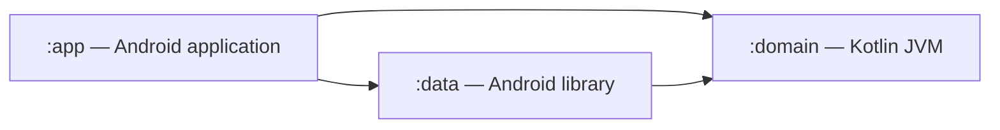
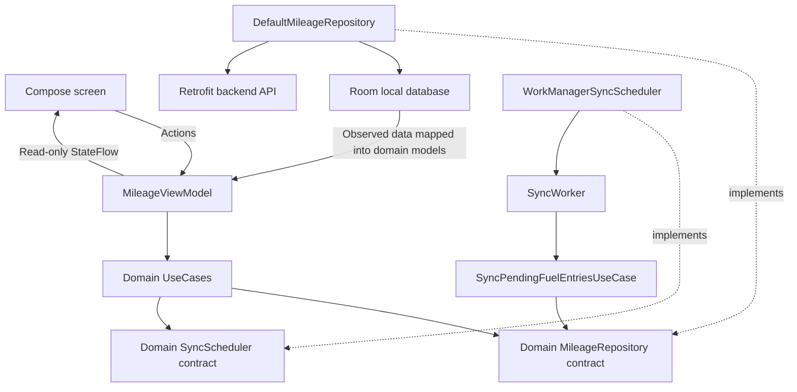

# Android architecture

The Android app uses three Gradle modules, MVVM with unidirectional state flow, an explicit domain UseCase layer, and manual constructor dependency injection. The design makes the business workflow independently testable while keeping Android, storage, networking, and authentication details outside the domain module.

This document describes the implemented Android code. The backend HTTP contract is documented separately in [OpenAPI](../docs/openapi.yaml), and installation/configuration instructions are in the [Android README](README.md).

## Module boundaries



These arrows represent Gradle/source dependencies, not the direction of runtime data flow.

| Module | Owns | Dependencies |
| --- | --- | --- |
| `:domain` | Models, business rules, UseCases, repository and scheduling contracts | Kotlin/JVM and coroutines; no Android plugin, Room, Retrofit, or Firebase |
| `:data` | Repository implementation, Room database/DAO/entities, Retrofit API/DTOs, authentication session adapter, transport error mapping | Domain and infrastructure libraries; no app dependency |
| `:app` | Compose UI, ViewModel, Activity, Google sign-in UI adapter, WorkManager adapters, dependency composition | Domain and data, plus Android UI/platform libraries |

The `:data` module is an Android library because Room requires Android. The domain module remains Kotlin/JVM. Gradle prevents domain from importing either outer module and prevents data from importing app classes. Additional architecture tests restrict presentation imports, since the app composition root legitimately needs access to concrete data implementations.

## Source map

| Location | Responsibility |
| --- | --- |
| [domain models and contracts](domain/src/main/kotlin/com/pandre/mileage/domain/) | Car/fuel models, amounts, totals, input validation and domain failures |
| [domain UseCases](domain/src/main/kotlin/com/pandre/mileage/domain/usecase/) | Explicit application actions and orchestration |
| [data implementation](data/src/main/java/com/pandre/mileage/data/) | Local/remote sources, mapping and repository policy |
| [presentation](app/src/main/java/com/pandre/mileage/ui/) | Immutable screen state, ViewModel and Compose rendering |
| [platform adapters](app/src/main/java/com/pandre/mileage/platform/) | Google account UI, WorkManager scheduling/factory and HTTP diagnostics |
| [MileageApplication](app/src/main/java/com/pandre/mileage/MileageApplication.kt) | Application composition root and WorkManager configuration |
| [MainActivity](app/src/main/java/com/pandre/mileage/MainActivity.kt) | Android entry point and ViewModel factory |
| [SyncWorker](app/src/main/java/com/pandre/mileage/SyncWorker.kt) | Maps synchronization outcomes to WorkManager results |

## Runtime flow and dependency inversion



UseCases depend on domain interfaces. `DefaultMileageRepository` and `WorkManagerSyncScheduler` implement those interfaces in outer layers. Runtime calls reach concrete infrastructure through the injected interfaces; the domain source never imports the implementing classes.

## Dependency injection

Dependency injection means an object's collaborators are supplied to it. A class does not construct its own repository, network client, or background scheduler.

For example, [AddFuelEntryUseCase](domain/src/main/kotlin/com/pandre/mileage/domain/usecase/AddFuelEntryUseCase.kt) declares the dependencies it needs:

```kotlin
class AddFuelEntryUseCase(
    private val repository: MileageRepository,
    private val scheduler: SyncScheduler,
)
```

The UseCase can validate and save an entry, then request synchronization, without knowing whether persistence uses Room or scheduling uses WorkManager.

### Composition root

[MileageApplication](app/src/main/java/com/pandre/mileage/MileageApplication.kt) chooses the concrete implementations and connects the graph. It constructs:

1. Firebase Authentication and its session adapter.
2. Room, the DAO, OkHttp, and the Retrofit API.
3. `DefaultMileageRepository`, exposed internally through `MileageRepository`.
4. `WorkManagerSyncScheduler`, used through `SyncScheduler`.
5. The domain UseCases that receive those contracts.

A representative binding is:

```kotlin
private val scheduler by lazy { WorkManagerSyncScheduler(this) }

val addFuelEntry by lazy {
    AddFuelEntryUseCase(repository, scheduler)
}
```

The repository stays private to the composition root. Presentation receives application actions through UseCases.

### Object lifetimes

| Object | Lifetime and owner |
| --- | --- |
| Repository, database/client graph, scheduler and UseCases | Application-instance lifetime, created on first access through `by lazy` |
| ViewModel | Owned by Android's ViewModelStore; created by the Activity's ViewModel factory and retained across configuration changes |
| SavedStateHandle | Supplied by the lifecycle factory for restorable small state, including selected car ID |
| Google sign-in UI adapter | Activity-scoped because credential UI needs an Activity context |
| Worker | Created for a WorkManager execution; receives its domain UseCase from the custom WorkerFactory |

`by lazy` provides initialization and retention of a property value. It is not itself a DI framework. Android lifecycle components own ViewModel and Worker lifetimes.

### ViewModel injection

[MainActivity](app/src/main/java/com/pandre/mileage/MainActivity.kt) uses `viewModelFactory` and `initializer` to pass the six observation/refresh/save UseCases and `SavedStateHandle` into `MileageViewModel`. The ViewModel never retrieves the Application, DAO, Retrofit client, or WorkManager.

The Activity accesses application-scoped dependencies at the composition boundary. That lookup is kept out of business and presentation classes.

### Worker injection

Android creates Workers through WorkManager, so a separate construction adapter is needed:

- `MileageApplication` implements `Configuration.Provider` and supplies [MileageWorkerFactory](app/src/main/java/com/pandre/mileage/platform/MileageWorkerFactory.kt).
- The manifest removes only WorkManager's default App Startup initializer so the custom configuration is used.
- The factory constructs `SyncWorker` with `Context`, `WorkerParameters`, and `SyncPendingFuelEntriesUseCase`.
- The Worker uses the injected UseCase and maps its outcome into WorkManager's `Result`.

[WorkManagerSyncScheduler](app/src/main/java/com/pandre/mileage/platform/WorkManagerSyncScheduler.kt) uses the application context and `WorkManager.getInstance(context)`. It schedules unique `fuel-sync` work with a network constraint and exponential backoff.

### Framework choice and trade-off

The project uses manual constructor injection without Hilt, Dagger, or Koin. Wiring and lifetimes are visible in ordinary Kotlin, and tests can instantiate domain actions with small fakes. The cost is maintaining the graph and factories by hand. Compiler checks catch missing constructor arguments, while tests protect orchestration and behavior; there is no DI-framework graph validation.

## Application UseCases

| UseCase | Behavior |
| --- | --- |
| `ObserveCarsUseCase` | Exposes the cached accessible-car stream through the domain contract |
| `ObserveCarHistoryUseCase` | Combines entries and last-refresh time into `CarHistory` |
| `ObserveCarStatisticsUseCase` | Observes car configuration and cached records to derive consumption and next-fueling estimates |
| `RefreshCarsUseCase` | Refreshes cars, then schedules pending-upload recovery after success |
| `RefreshCarHistoryUseCase` | Validates car identity, refreshes its history, then schedules upload recovery |
| `AddFuelEntryUseCase` | Validates car identity and input, saves locally, then schedules upload |
| `SyncPendingFuelEntriesUseCase` | Invokes synchronization and returns explicit `COMPLETE` or `RETRY` outcomes |

Simple observation wrappers are intentional: this project demonstrates a consistent application boundary even for actions with little orchestration. UseCases do not duplicate HTTP requests or Room queries. Persistence, source selection and cache policy remain repository responsibilities.

## Presentation and state ownership

`MileageScreen` collects the ViewModel's read-only `StateFlow` with lifecycle-aware Compose APIs and connects actions to callbacks. `MileageContent` renders supplied state without retrieving dependencies. Transient form inputs use `rememberSaveable`; the ViewModel owns screen operations and dialog state.

`MileageUiState` describes cars, selection, history, refresh time, loading, errors, access blocking and editing. Its mutable backing flow is private. The selected car ID is written to `SavedStateHandle`.

Switching cars cancels the prior observation and refresh operation, clears old-car history, and guards against stale results. Coroutine cancellation propagates instead of becoming a user-visible error. A ViewModel survives configuration changes; SavedStateHandle and Room address different restoration needs. Current tests do not prove full process-death restoration.

## Local persistence and synchronization

Room is the local source observed by the UI. DTOs and entities are mapped into domain models inside data. History refresh fetches the complete server history, replaces synced local records in a transaction, preserves pending/failed records, and records the refresh time. Failed refreshes preserve the cache.

When saving a fueling:

1. The ViewModel parses the form into integer hundredths/cents and creates a domain input.
2. `AddFuelEntryUseCase` validates and asks the repository to save.
3. The repository serializes the local duplicate-date check and write, assigns a stable UUID, and persists a pending entry with the creating user identity.
4. The UseCase calls `SyncScheduler` after the save succeeds.
5. WorkManager runs the injected synchronization UseCase when connectivity permits.
6. The repository uploads the same UUID on retries, stores confirmed results, and refreshes history.

Temporary transport/server failures remain retryable. Permanent validation/conflict failures are retained with a failed status. The backend remains authoritative for membership, one-record-per-date and chronological odometer validation across devices.

Room insertion and WorkManager enqueue are separate operations, not one atomic transaction. The pending queue is durable, and successful car/history refreshes also schedule upload recovery. The design provides eventual retry; it does not claim exactly-once network delivery. Stable IDs provide idempotency at the backend.

## Domain data rules

- Kilometers, liters and EUR are the initial scope.
- Liters and total paid are stored as integer hundredths and cents; inputs accept at most two decimal places.
- Price per liter is derived with half-up rounding to two decimals.
- Totals include pending and synced purchases and exclude rejected records.
- The app tracks fuel purchases, without inferring fuel consumption.
- One account belongs to a phone installation; switching requires clearing app data, which removes unsynced local entries.

## Authentication and errors

The Activity-scoped Google sign-in adapter obtains a credential and signs into Firebase. The data-layer session adapter supplies a Firebase ID token to Retrofit calls. The backend verifies identity and checks provisioning and car membership. Google sign-in alone does not grant access to car data.

The data repository translates HTTP, network and Firebase session failures into domain failure categories. The ViewModel maps those into user-facing state. The Worker maps retryable domain failures to retry, access/session failures to failure, and explicitly rethrows cancellation.

Debug HTTP diagnostics log request metadata and correlation IDs without authorization headers or request/response payloads. Runtime configuration is read from ignored local properties or Gradle properties; source examples use placeholders.

## Tests and architecture checks

| Test boundary | What it verifies |
| --- | --- |
| Domain JVM tests | Amount rules, totals, validation, UseCase orchestration, save-before-schedule ordering and cancellation |
| Data JVM tests | DTO mapping, HTTP contract, retry decisions, duplicate local dates and domain error translation |
| App JVM tests | ViewModel loading/error/save behavior, stale-selection cancellation, lifecycle cancellation and source dependency rules |
| Compose device tests | Screen rendering and callbacks through semantics, with explicit fixtures |
| Room device test | History replacement, pending/failed record preservation and duplicate-row merging |
| Worker device tests | Constructor injection, completion/retry/access-failure mapping and cancellation |

Tests replace repositories and schedulers through their constructors. The instrumentation runner uses a plain test Application so screen and Worker fixtures never initialize the live Firebase dependency graph. Screen tests are distinct from full Activity/navigation tests and do not establish live provider availability.

From this `android/` folder:

```sh
bash scripts/kotlin-style.sh --check
./gradlew :domain:test :data:testDebugUnitTest :app:testDebugUnitTest
./gradlew :app:assembleDebug :app:lintDebug :data:lintDebug
./gradlew :app:connectedDebugAndroidTest
```

Connected tests use an API 36 emulator. See [verification history](../docs/IMPLEMENTATION_STATUS.md) for actual recorded runs and limitations.

## Engineering guidance

[AGENTS.md](AGENTS.md) defines the Android project conventions. The six workflows in [.agents/skills/](.agents/skills/) guide Kotlin style, architecture, feature development, investigation and testing. [The conventions guide](../docs/ANDROID_CONVENTIONS.md) describes formatting tooling and testing practices in more detail.

## Fueling statistics

`ObserveCarStatisticsUseCase` combines the selected car configuration and cached entries, using pure Kotlin `CarStatistics` calculations. `MileageViewModel` receives it through constructor injection and resets statistics when switching cars. Compose renders the returned estimates without reading repositories or calculating business formulas. Room migration 1 → 2 adds the nullable initial range column without destroying pending records. See [statistics behavior and provisioning](../docs/CAR_STATISTICS.md) for formulas and assumptions.
